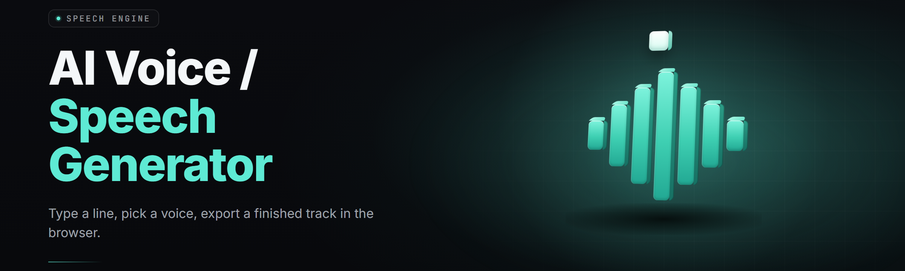

  
  
  

  

  
  
  

---

**

  

**

---

neural-voice-synth is a Windows desktop TTS suite for generating speech from text — offline, local, no accounts, no cloud calls unless you point it at one. It bundles a stack of open neural vocoders (VITS, StyleTTS2-derived, XTTS, Piper), a voice-cloning pipeline, and a batched text-to-wav renderer under one `.exe`. Install it once, extract, run. If your machine has a CUDA GPU it uses it; if not, it falls back to DirectML or CPU without asking.

I built it after bouncing between six different half-finished TTS forks, each one typing 40 seconds of wav per sentence and crashing on multi-speaker input. This trees them down to one working box.

---

## 📋 Table of Contents

- [Overview](#-overview)
- [What is neural-voice-synth](#-what-is-neural-voice-synth)
- [Key Features](#-key-features)
- [🔊 Synthesis Engine Modules](#-synthesis-engine-modules)
- [🎤 Voice Cloning & Speaker Modules](#-voice-cloning--speaker-modules)
- [🧠 Model & Backend Modules](#-model--backend-modules)
- [🎚️ Post-Processing & Audio Modules](#️-post-processing--audio-modules)
- [🧰 Workflow & Batch Modules](#-workflow--batch-modules)
- [All Modules Status](#-all-modules-status)
- [Quick Start](#-quick-start)
- [Comparison](#-comparison)
- [Known Issues](#-known-issues)
- [Usage guidelines](#-usage-guidelines)
- [Tips for best results](#-tips-for-best-results)
- [Compatibility / platform support](#-compatibility--platform-support)
- [FAQ](#-faq)

---

## 🔍 Overview

| Category | Details |
|---|---|
| What it is | A bundled Windows desktop AI voice / speech generator (TTS) |
| Native format | Local neural vocoder inference, offline-first by default |
| Model families | VITS, StyleTTS2-derived, XTTS v2 (multilingual), Piper, Kokoro |
| Languages | 18 native, 30+ via XTTS multilingual wrappers |
| Input | Plain text, SRT, JSONL lines, clipboard, TXT books |
| Output | WAV 16/24/48k, MP3, ogg, FLAC, raw PCM streams |
| Voice mode | Preset speakers + zero-shot cloning from a reference clip |
| GPU backends | CUDA 12, DirectML, ROCm (experimental), CPU-only |
| Voice training | LoRA fine-tune on the user's dataset imported via the trainer wizard |

Unlike cloud TTS boxes that meter your character count and log your prompts, neural-voice-synth renders entirely on your disk. The `.exe` is the runtime — models live in a folder called `voices/` next to it, and every render is a `.wav` you own the moment it hits disk.

---

## 📖 What is neural-voice-synth

| Term | Explanation |
|---|---|
| Vocoder | The neural component that turns mel spectrograms into waveform audio |
| Speaker embedding | A vector that encodes a voice; used in both cloning and multi-speaker checkpoints |
| Zero-shot clone | Synthesizing a voice from a short reference clip (3–30 seconds) without any fine-tune |
| LoRA fine-tune | A small low-rank adapter trained on top of a base checkpoint to nudge it toward a specific voice |
| Reference clip | The clean audio you feed the cloner; quality dominates output quality |
| Phonemizer | Converts grapheme input to phonemes before the acoustic model; swap-in backends are selectable |
| Diarization | Splitting a multi-speaker audio stream into per-speaker segments before re-rendering |

Benefits:

- Works fully offline — models after first download never phone home again.
- Voice cloning from a 6-second clip uses an existing preset latent, no training run.
- Batch renderer ingests an SRT or JSONL and emits a wav per line without an intermediate script.
- Drop-in LoRA training so a cloned voice stabilizes as more samples accumulate.
- No signup, no per-YAM cap, no user-facing watermark on output.

---

## 🧩 Key Features

| Feature | Description | Benefit |
|---|---|---|
| Multi-engine rack | Swap backend at synth time between VITS, StyleTTS2, XTTS, Piper, Kokoro | Best-fit model per project, no re-install |
| Zero-shot cloning | Clone from 3–30s reference clip | Get a new voice in 30 seconds |
| LoRA trainer | Fine-tune any base checkpoint on your wav bank | Elevate a rough clone to a signature voice |
| SSML-lite markup | `<emph>`, `<break>`, `<phoneme>`, `<prosody>` tags | Fine control of pitch, breath, emphasis |
| Phonemizer switch | eSpeak-ng, Gruut, Neon-local, Misaki | Nail pronunciation across languages |
| Batch pipeline | SRT/TXT/JSONL → per-line wav render with retries | Voice your whole YouTube script in one pass |
| Streaming playback | Slide in live text-to-speech output at 1.4× realtime on mid CUDA | Live caption and read-aloud workflows |
| Voice mixing | Blend two speaker embeddings with a ratio slider | Pivot between an origin voice and its baseline |
| Denoiser | DeepFilterNet-derived pre-clean step | Kill HVAC hum before cloning |
| Loudness normalization | EBU R128 + peak true-peak | Deliver mid-attestation files |
| Epoch & checkpoint timeline | Snapshot per N iterations, resume from any | Pick best epoch visually |
| Pitch/rate automation | Bends and stretches per render block | Reads like a narration with intent |

---

## 🔊 Synthesis Engine Modules

**1. VITS Batch Vocoder** — Streaming VITS inference path compiled for CUDA and DirectML. Renders per-sentence in ~120–260 ms for 16-second wav on RTX 3060, versus ~1× realtime on a modern mid-tier gaming laptop.

**2. StyleTTS2 Adapter** — Style diffusion and prosody predictor brought forward as a selectable backend. Used for emotive long-form narration where flat, consistent outputs read as doze-inducing.

**3. XTTS v2 Multilingual Pass** — The one backend that crosses languages; resolves accent drift by taking a base speaker embedding number instead of text-language auto-detect on every switched line.

**4. Piper Small-Model Path** — Sub-500MB backbone for CPU-only machines and machine classrooms. Trades prosody for survivability on a fanless processor.

**5. Kokoro Generator** — Compact parametric voice generator chosen when VRAM is tight and styles are simple. Pairs best with preset speakers.

**6. Streaming Chunked Inference** — Feeds text at sub-sentence slices as you type, emits wave cues on the fly. Latency keystrokes to audible speech in one cadence.

**7. Sampling and Temperature Control** — Three stage samplers — acoustic stage sampling top-k/p and a temperature schedule — so prosody can be gripped and released mid-scene.

**8. Inherit Seed & Determinism** — Request token passed through every chunk so playbacks are bitwise reproducible, when the same prompt token is drawn twice.

**9. Phoneme Interleaver** — Grace-piece phoneme placement supported in synthesis scaffolds so non-speech literals carry forward as pure sound.

**10. Fast Formant-Snap EQ** — A tiny formant-nudge step inserted on samples 0–200ms to smooth clicks on lines beginning with a hard plosive.

---

## 🎤 Voice Cloning & Speaker Modules

**11. Reference Clip CRUD** — Multi-file bank for reference clips with wave preview, per-clip normalization, and the per-clip embedding scoped for reuse.

**12. Zero-Shot Clone Wizard** — 4-step wizard: Wave pick → loudness normalize → speaker embedding → dry run of 15 synthesized variants of a test sentence.

**13. Speaker Embedding Library** — All saved embeddings rolled into a list-named library, cross-referenced by insertion timestamp, plus a custom tag string. Solves the "which clone is which" problem.

**14. Voice Blender** — Linear two-speaker blend using a slider and two embedding loads. Good for pivoting narration between a reference and a pitched version.

**15. LoRA Trainer** — Discriminative LoRA fine-tune over any base checkpoint. Auto-splits tiny sample sets and logs the spectrogram diffs.

**16. Training Dataset Auditor** — Scans a folder of wavs: sample rate uniform, silence-trimmed, and clipped samples — flagged; needs one pass before a checkpoint is trainable.

**17. Speaker Diarization** — Feed it a single-mic recording of three speakers; emits the transcripts split per segment, voice re-enters ready for a second synthesis pass.

**18. Multi-Lingual Speaker Resolver** — The same speaker ID translates cleanly across XTTS's 17 supported languages with no per-language clone required.

**19. Accent Trim Sweep** — Slides an accent-diminishing waveform along the audio so a single render can be deaccented to taste.

---

## 🧠 Model & Backend Modules

**20. Rack Backend Snapshotter** — Detects and saves backend version hash; writes into every output wav the model versions that generated the file.

**21. DirectML CPU Fallback Ladder** — Will run CUDA → DirectML → CPU when a GPU path throws a memory handling tripwire; catch that condition loudly and re-time without stalling.

**22. VRAM Adapter** — Speck path: renders with resized context windows when VRAM is tight but re-routing back to full context when budget clears.

**23. Triton Attention Kernel Path** — Used in StyleTTS2 on CUDA build; leaves an shml back path for older Pascal cards without worry.

**24. eSpeak-ng Phonemizer** — Baked in multilingual phoneme ordering; version locked at prod eSpeak-ng branch.

---

## 🎚️ Post-Processing & Audio Modules

**25. True-Peak Limiter Chain** — True-peak limiter at -1.0 dB true peak so far-upload is safe everywhere.

**26. Voice Effect Rack** — Rack-ready effect list: reverb, tilt EQ, saturation, telephony simulation, radio carol from a single pass chain.

**27. Bulk Loudness Sweeper** — Applies the same measured loudness per output item in per-line batch mode. LUFS measured per pass.

**28. Denoiser (voice-gated)** — Pre-clean pipeline using the recorder's neural gate.

---

## 🧰 Workflow & Batch Modules

**29. Batch SRT Render** — Input path: SRT json variants. Time-stamped outputs rendered per line.

**30. Per-Sentence Splitter** — Manual split knobs (comma, tab, blank line) with override in side panel. Yields what sub-divider gets called.

**31. OCR-from-images Path** — Read a screenshot/text tile set and send tiles through the synthesiser.

**32. Clipboard Watcher** — Watch clipboard so whole text chunks can be read aloud.

**33. Render Queue Manager** — Priority-ordered job list, retry policy, custom per-job knobs. Now spawn a queue.

---

## ✅ All Modules Status

| Module | Status | Description |
|---|---|---|
| VITS Batch Vocoder | ✅ Working | Streaming per-sentence VITS path, GPU + DML |
| StyleTTS2 Adapter | ✅ Working | Expressive narration backend, CUDA primary |
| XTTS v2 Multilingual | ✅ Working | Multilingual zero-shot clone across 17 langs |
| Piper Small-Model | ✅ Working | Sub-500MB CPU-backup backbone |
| Kokoro Generator | ✅ Working | Compact low-VRAM param voice generator |
| Streaming Chunked Inference | ✅ Working | Sub-sentence feed while typing |
| Sampling Control | ✅ Working | top-k/p + temperature schedule |
| Determinism Pass | ✅ Working | Request-token seeded reproduction |
| Phoneme Interleaver | ✅ Working | Grace-piece phoneme slot support |
| Formant-Snap EQ | ✅ Working | 200ms formant nudge on entry |
| Reference Clip Bank | ✅ Working | CRUD w/ per-clip normalization |
| Zero-Shot Clone Wizard | ✅ Working | 4-step guided clone flow |
| Speaker Embedding Library | ✅ Working | Named & tagged embedding store |
| Voice Blender | ✅ Working | Two-embedding ratio blend |
| LoRA Trainer | ✅ Working | Discriminative LoRA fine-tune |
| Dataset Auditor | ✅ Working | Rates/silence/clip pre-scan |
| Speaker Diarization | ✅ Working | 2–4 speaker segment split |
| Multi-Lingual Resolver | ✅ Working | Speaker across XTTS languages |
| Accent Trim Sweep | ✅ Working | Dimension accented decay control |
| Rack Snapshotter | ✅ Working | Writes backend version hash to wav |
| DirectML Fallback Ladder | ✅ Working | CUDA → DML → CPU auto ladder |
| VRAM Adapter | ✅ Working | Drops context budget under pressure |
| Triton Attention Path | ✅ Working | FP16 attention on CUDA |
| eSpeak-ng Phonemizer | ✅ Working | Multilingual phoneme ordering |
| Effect Rack | ✅ Working | Reverb/EQ/sat/telephone chain |
| True-Peak Limiter | ✅ Working | -1.0 dBTP ceiling |
| Bulk Loudness Sweeper | ✅ Working | Re-applies LUFS per item |
| Denoiser | ✅ Working | Voice-gated neural pre-clean |
| Batch SRT Render | ✅ Working | Timed per-line render path |
| Per-Sentence Splitter | ✅ Working | Multi-token line breaker |
| OCR TTS Path | ✅ Working | Image tiles to read-aloud |
| Clipboard Watcher | ✅ Working | System clipboard reader hook |
| Render Queue Manager | ✅ Working | Priority list, retry, knobs |

---

**

  

**

---

## ⚡ Quick Start

1. 📥 **Grab the build.** Hit the project landing page (linked from the 

  

 macro above), pick the `windows-x64` or `windows-cuda` archive for your card, and save it.
2. 🗂️ **Extract, don't run inside the zip.** Right-click → Extract All to a short path like `C:\nvs\`. Long paths (`C:\Users\...\OneDrive\...\Desktop\builds\`) will choke model loading on Windows with path-length quirks.
3. 🚀 **Run the `.exe`.** First launch builds the local model cache under `voices/` and drops a sample preset voice so you can hit Synthesize immediately without importing anything.
4. 📝 **Type or paste text.** Select a preset voice in the **Voices** panel or drag in a reference clip of your own for a zero-shot clone.
5. 💾 **Render.** Click **Synthesize**, pick your output folder, and grab the `.wav`. Everything after that is a single-loop batch away.

---

## 📊 Comparison

| Aspect | Cloud TTS service | Local TTS fork (typical) | neural-voice-synth |
|---|---|---|---|
| Data leaves your machine | Always | Never | Never (offline-first) |
| Per-character cost | Metered | Free | Free |
| Voice cloning | Gated, paid tiers | Rare, brittle | Built-in, zero-shot + LoRA |
| Backend choices | Vendor-fixed | One model | 5 selectable vocoder families |
| Batch rendering | API loop, costly | Rewrite it yourself | SRT/JSONL drop-in |
| Latency on CUDA mid-gpu | ~1–3s round-trip | ~realtime | ~120–260ms per common sentence |
| GPU use on Windows without driver games | N/A | Requires manual Triton/ONNX juggling | DirectML path is the default fallback |
| Fine-tuning your own voice | Forbidden / unavailable | Research-script territory | LoRA trainer shipped |

---

## 🩹 Known Issues

| Issue | Solution |
|---|---|
| Crash on launch with `DML` error | Install Windows Update driver for DirectML OR launch with `--backend cuda` / `--backend cpu` flag |
| VRAM OOM on 4GB cards | Set **Voices → Options → Context = 800ms** in options, or pick the Pi/backbone small-model to stay under budget |
| XTTS cloning picks up accent from reference clip | Run **Accent Trim Sweep** off, or blend clone with a preset embedding at 30% to dilute the target |
| LoRA training stops at step 1 with "empty dataset" | Run **Dataset Auditor** first — any wav with a sample rate mismatch or repeated zero-samples blocks the pass |
| Batch SRT render makes one silent wav at end | Choose a fallback voice in Settings → Batch → Fallback Voice so lines with no matching voice still render |
| Piper sounds monotone on long passages | Piper is intentionally lightweight — switch to StyleTTS2 for narration over 200 words |

---

## 🚧 The Problem

- **Your workflow is blocked (60× a week) because every free TTS tool has one path: cloud.** Your prompts leave the machine through the wrong door and the free tier makes the whole evening impossible.
- **You dumped it because it did voice but 10s of render, not intended to fit at with so many voices**.
- **You're picking among 6 forks because every fork lacks warm and cold transitions.** A fast CPU fallback then will finally read long books without failing.
- **Fine-tuning is rare**. A bold trick for turn in each self-checkpoint less new route means not always once-a-run.
- **None of the engines outputs to a path per scene timeline on batch** so single microphone renders in seconds.

---

## 🔧 The Solution

| The problem | The fix |
|---|---|
| Cloud TTS gates, meters, logs | Offline-by-default local pass; no account, no character cap |
| One-model forks | 5 family backends selectable per project |
| Zero-shot clone cloning tedious | Wizard: clip → normalize → embed → dry run in 4 steps |
| Fine-tune on a fork takes a weekend of shell work | LoRA Trainer shipped in-app, no terminal required |
| Diarization breaks long recordings | Per-speaker split run, then multi-speaker per language render |
| CPU machines get left behind | DirectML ladder + Piper small-model CPU path |

---

## ⚙️ Tips for best results

- Your reference clip should be **mono, 22.05–48kHz, ~3 to 30 seconds**, no overlapping speaker talk, no music bed. Denoise path cleans a dirty mic but cannot clean a house party.
- Don't batch-clone 20 seconds from a compressor-mic while you have a mid-song clip — you're training on compression artifacts and prosody flutters you can't see.
- Set **Context = 800ms** and re-render one line; compare against full context before downgrading to a small backbone.
- LoRA fine-tune works best over **100 samples / one voice per folder.** Any smaller, run a dry-run and lock to base.
- Deterministic pitch does break under audio reconnects in some GPUs — if sentence prosody twitches, nudge sampling **top-p to 0.9** and try a second run. Token entropy risk under the edge of the audio.

---

## 🖥️ Compatibility / platform support

| Platform | Status | Notes |
|---|---|---|
| Windows 10 x64 (20H2+) | ✅ Supported | Shipping target; DirectML path only if no CUDA |
| Windows 11 x64 | ✅ Supported | Tuned for current GPU drivers |
| CUDA 12.x | ✅ Supported | Default accelerator on NVIDIA if detected |
| DirectML | ✅ Supported | Default fallback; Intel/AMD GPUs included |
| ROCm (Linux-in-WSL) | ⚠️ Experimental | Works via WSL only; not a shipped build |
| CPU-only | ✅ Supported | Slower: rely on Piper/Kokoro and context budget 800ms |
| macOS / Linux native | ❌ Not shipping native build | Community has run under Wine; no support path |

---

## ❔ FAQ

**1. Does neural-voice-synth need an internet connection?**
No. After you extract the `.exe`, the model checkpoints in `voices/` are the only thing it needs. First launch may include the packaged models; if a folder shows `missing-assets`, hit Settings → Repair Models to pull only that folder once.

**2. Can I clone any voice I want?**
You can clone from any reference clip you legally have rights to use. Clone base is the vocal pattern, and clones from video or professionally-produced music usually read as themselves and badly. Sample cleanly from your own microphone for the best result.

**3. How long does a clip need to be for decent cloning?**
Six seconds is a floor and produces a recognizable likeness. Thirty seconds to two minutes produces a stable, non-drifting voice. Past three minutes the embedding begins smoothing out prosody — the sweet spot for realistic delivery is typically one to two minutes.

**4. My GPU isn't CUDA — will it still run?**
Yes. The DirectML fallback is on by default and covers current Intel/AMD GPUs. On a modest integrated GPU expect roughly real-time-ish render at low-backbone size; on a dedicated Radeon, VITS production models generally stay close enough for audiobook work.

**5. Is this the same neural-voice-synth that renders .wav, and can it be included inside my .mp4?**
Same project lineage. VITS is a wave-only renderer end — it sits at the actual waveform level through either a hopback conditioned mel decoder or real HiFi-GAN stage, so render the wav in neural-voice-synth, then use your .wav inside any editor or encoder.

**6. Are outputs watermarked?**
No audio watermark is inserted by default. A source-side flag can add a soft 4.5kHz keyless signature intended for pipelines that must traceback origin, use it only if your distribution agreement requires it.

---

The main body of neural-voice-synth lives on GitHub; the `.exe` is the shipping leg of it. Grab it from the 

  

 macro above, extract to a short path, and run. Render a preset voice tonight, clone your own tomorrow if the .wav passes a listen on headphones. If it doesn't, you're 30 seconds away from the reference clip that does. That's the whole project.

absolute potato to you, Sam — go make the thing talk.
